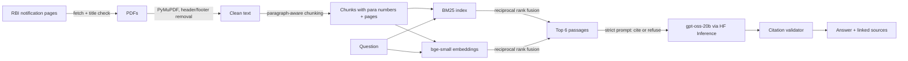

# Ask RBI

**Plain-English answers about Indian banking rules, with every claim linked to the exact paragraph of the Reserve Bank of India's 2025 Master Directions.**

[](https://github.com/das9souvik/ask-rbi/actions/workflows/tests.yml)


**Live demo:** _coming soon on Hugging Face Spaces_

> "How quickly must a bank close my credit card after I ask?"
> → A direct answer, then the source: *Credit and Debit Cards Directions, para 8*, with a link straight to that page of RBI's PDF.

---

## Why this exists

On **28 November 2025** the RBI consolidated its regulations into 244 Master Directions and withdrew **9,445** older circulars. Most "chat with RBI" tools and many blog posts still quote the superseded rules.

Ask RBI is built only on the **current consolidated directions** and is designed around three things a compliance or product team actually needs:

1. **Citations you can check.** Every factual sentence carries a source tag that maps to a real paragraph and page. Citations to sources that don't exist are detected and stripped.
2. **Knowing when to say no.** Questions outside the indexed directions ("What's the repo rate?", "Should I buy bank shares?") are refused instead of answered from the model's memory.
3. **Measured, not vibes.** A versioned evaluation set reports retrieval accuracy, groundedness and refusal behaviour on every change.

## How it works



| Step | Choice | Why |
|---|---|---|
| Source of truth | RBI's own notification pages | The fetcher checks each page's title against the manifest before downloading, so a wrong ID fails loudly instead of indexing the wrong rules. |
| Chunking | Split on RBI paragraph numbers (`7.`, `12.3`), ~260 words, small overlap | Keeps rules intact and gives citations like *paras 8–9* instead of "chunk 412". |
| Retrieval | BM25 + dense embeddings, fused with RRF | Regulations are full of exact terms (V-CIP, EBLR, SMA-2) that keyword search nails and embeddings blur; embeddings catch paraphrases ("close my card" → "closure of credit card"). |
| Embeddings | `BAAI/bge-small-en-v1.5` (33M params) | Strong retrieval quality, runs on a free CPU Space. |
| Answer model | `openai/gpt-oss-20b`, fallback `Qwen2.5-7B-Instruct` | Free through Hugging Face Inference Providers; switchable with one environment variable. |
| Guardrails | Cite-or-refuse prompt, citation validator, relevance gate | A relevance gate skips the model entirely when nothing relevant is retrieved, which saves cost and stops "creative" answers. |

## Documents covered (v1)

The retail-banking slice of the 2025 consolidation, plus the two key payments directions:

Responsible Business Conduct · Know Your Customer · Credit and Debit Cards · Credit Facilities · Interest Rates on Advances · Interest Rate on Deposits · Income Recognition, Asset Classification and Provisioning · Credit Risk Management · Credit Information Reporting · Wilful and Large Defaulters · Digital Banking Channels · Payment Aggregators · Prepaid Payment Instruments

The full list with RBI titles is in [`data/manifest.toml`](data/manifest.toml). Adding a document is one entry.

## Evaluation

`eval/questions.jsonl` holds 25 in-scope questions (each tagged with the directions that should answer it and key terms that should appear) and 6 out-of-scope questions that must be refused.

| Metric | What it measures | Result |
|---|---|---|
| doc_hit@6 | Right direction in the top 6 passages | _first run pending_ |
| keyword_hit@6 | Key regulatory term present in retrieved text | _pending_ |
| MRR | How high the right direction ranks | _pending_ |
| grounded_rate | Answers that cite real sources and invent none | _pending_ |
| correct_doc_cited | Answers citing the expected direction | _pending_ |
| refusal_rate (out of scope) | Off-topic questions correctly refused | _pending_ |

Full per-question results are written to [`eval/results.md`](eval/results.md). The gold set was written by a practitioner and is reviewed against the source text; where the 2025 consolidation moved a rule, the expected document list allows for it.

## Run it yourself

Requires Python 3.11 or 3.12 and a free [Hugging Face token](https://huggingface.co/settings/tokens).

```bash
git clone https://github.com/das9souvik/ask-rbi && cd ask-rbi
make setup                      # Python 3.12 venv via uv, installs everything
cp .env.example .env            # add your HF token
make fetch                      # download the directions from rbi.org.in
make build                      # parse, chunk, embed -> index/
make eval                       # writes eval/results.md
make app                        # http://127.0.0.1:7860
```

Tests run offline with a hashing embedder and a fake model, so CI needs no downloads or keys: `make test`.

## Project layout

```
ask_rbi/
  fetch.py      resolve + download PDFs, verify titles, record SHA-256 in data/raw/sources.json
  parse.py      PDF -> clean page text (header/footer removal, de-hyphenation)
  chunk.py      paragraph-aware chunks that keep RBI para numbers and pages
  embed.py      bge-small embedder + offline hashing embedder
  index.py      build/save/load chunks, embeddings and BM25
  retrieve.py   hybrid search with reciprocal rank fusion
  generate.py   cite-or-refuse prompting and citation validation
  pipeline.py   build_index() and AskRBI.ask()
  evaluate.py   retrieval + answer metrics, writes eval/results.md
app.py          Gradio demo
eval/           gold question set and results
tests/          offline test suite (runs in CI)
```

## Limitations

- **Not legal advice.** Always confirm against the official RBI text; links go straight to RBI's PDFs.
- **Snapshot in time.** Directions are amended; `data/raw/sources.json` records exactly which file and hash each answer is based on. Re-run `make fetch build` to refresh.
- **Scope.** v1 covers commercial banks' retail-facing directions and two payments directions, not NBFCs, co-operative banks or FEMA.
- **Tables and annexes.** Complex PDF tables are flattened to text, so figures inside large tables may retrieve less reliably.

## Roadmap

- [ ] Version awareness: answer "what changed in the latest amendment?"
- [ ] Cross-encoder re-ranking and an LLM-judged faithfulness score in the eval
- [ ] NBFC and Small Finance Bank directions
- [ ] Hindi questions

---

Built by **Souvik Das**, data scientist in BFSI (customer analytics, propensity and cross-sell modelling). Feedback and issues welcome.

*Ask RBI is an independent educational project and is not affiliated with or endorsed by the Reserve Bank of India.*
